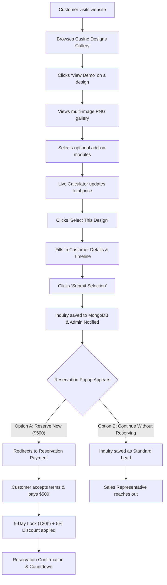

# ALL I GAMING — Complete Project Specification & Requirements

**Project Name:** ALL I GAMING  
**Platform Type:** B2B Online Casino Platform Marketplace, Design Selection & Reservation System  
**Design Theme:** Luxury Modern — Deep Black, Royal Purple, Metallic Gold, and Subtle Neon Accents  
**Nature of Business:** **B2B Platform Sales & White-label Solutions Marketplace** (NOT an online gambling / betting site).

---

## 1. Project Overview & Core Concept

**ALL I GAMING** is a high-end B2B marketplace platform enabling entrepreneurs, gaming operators, and business owners to:
1. Browse ready-made online casino platform designs.
2. Preview multiple high-resolution PNG mockups for each design in an interactive demo gallery.
3. Configure their platform by adding optional modules (Live Dealer, Sportsbook, Poker, Sweepstakes) onto the **$15,000 USD Starter Package**.
4. View real-time dynamic package pricing and submit their project inquiry.
5. Optionally reserve their chosen design with a **$500 USD fully refundable reservation fee**, which locks their design and discounted package price (with an exclusive **5% discount**) for **5 days (120 hours)**.

### The System Consists of Two Main Portals:
- **Public Customer Marketplace:** Sleek, high-converting luxury storefront for browsing, interactive demo previews, configuration calculator, inquiry submission, and optional reservation checkout.
- **Admin Management Dashboard:** Complete back-office control for managing casino designs, uploading unlimited PNG mockups, reordering previews, modifying pricing & GGR percentages, tracking customer inquiries, managing 5-day reservations, automated expiration & refund tracking.

---

## 2. Customer Website Pages & Architecture

### Public Pages:
| Page | Path | Purpose |
| :--- | :--- | :--- |
| **Home** | `/` | Luxury landing page, hero banner, featured designs, starter package breakdown, optional modules, how it works, and CTA. |
| **Casino Designs** | `/designs` | Full responsive gallery of all active casino designs (3x4 grid on desktop) loaded from MongoDB. |
| **Casino Demo** | `/designs/[slug]` | Interactive multi-image PNG viewer with fixed pricing sidebar, add-on selector, and live price calculator. |
| **Packages** | `/packages` | Detailed explanation of the $15,000 Starter Package and what is included. |
| **Add-On Modules** | `/modules` | Overview of all optional modules with pricing and technical capabilities. |
| **How It Works** | `/how-it-works` | 4-step explanation of the selection, reservation, agreement, and launch process. |
| **About Us** | `/about` | Company introduction as a premier B2B casino platform reseller and solution provider. |
| **Contact Us** | `/contact` | Professional contact form, direct email, WhatsApp, and Telegram contact options. |

### System & Conversion Flow Pages:
- `/select-design`: Selection summary + customer information submission form.
- `/reservation/[id]`: Secure payment & terms acceptance page for the $500 reservation fee.
- `/confirmation/submission`: Post-submission confirmation for standard inquiries.
- `/confirmation/reservation`: Post-payment confirmation page displaying locked 5% discount, remaining balance, and 120-hour countdown.

---

## 3. Product & Pricing Architecture

### A. Basic Package ($15,000 USD — Mandatory Base)
- **Includes:** Casino Slot Games, Casino Table Games, Account Management, Basic CMS & Payment Gateways.
- **Excludes:** Live Dealer, Sportsbook, Poker, Sweepstakes.

### B. Add-On Modules (Dynamic Admin Configurable)
| Module | Default Price |
| :--- | :--- |
| **Live Dealer Casino** | $10,000 USD |
| **Sportsbook Platform** | $10,000 USD |
| **Poker Platform** | $20,000 USD |
| **Sweepstakes Module** | $25,000 USD |

### C. GGR Share Model
- **Platform Provider:** 25%
- **Operator (Client) Share:** 75%

### D. Optional 5-Day Reservation Model
- **Reservation Fee:** $500 USD (100% Refundable)
- **Duration:** 5 Days (120 Hours)
- **Exclusive Benefit:** 5% Discount across the entire selected package (Base + Add-ons)
- **Fee Handling:**
  - If Deal Closes: The $500 fee is credited toward the discounted total.
  - If No Agreement is Reached: Full $500 refund initiated; design hold & 5% discount released.

---

## 4. End-to-End Customer Workflow

---

## 5. Admin Dashboard Requirements

1. **Dashboard Overview:** Metric cards for Total Designs, Active Selections, Active Reservations, Expiring Reservations, Completed Deals, and Pending Refunds.
2. **Casino Designs Management (Mandatory PNG Upload System):**
   - Create/Edit/Delete designs.
   - Upload primary gallery thumbnail PNG.
   - Batch upload multiple preview PNGs per design.
   - Drag-and-drop reordering of preview images.
   - Set titles for individual preview PNGs.
   - Set status: `Active`, `Hidden`, or `Unavailable`.
3. **Pricing & Module Management:**
   - Modify Starter Package base price ($15,000 default).
   - Edit prices for existing add-ons or create new ones.
   - Adjust GGR split percentages (25% / 75%).
   - Adjust reservation fee ($500) and discount percentage (5%).
4. **Customer Selections Management:**
   - Full list of all submissions (lead tracking).
   - Filter by status (`New Inquiry`, `Contacted`, `Reviewing`, `Offer Sent`, etc.).
   - Internal notes on customer records.
   - Export to CSV/Excel.
5. **Reservation Management:**
   - Track 120-hour timers and active price locks.
   - Statuses: `Pending Payment`, `Active Reservation`, `Agreement Completed`, `Expired`, `Refund Pending`, `Refunded`, `Cancelled`.
   - Actions to mark "Agreement Completed" or manually initiate/confirm refunds.
6. **Automated Expiration & Background Job:**
   - Server-side cron/job running periodically to check for reservations exceeding 120 hours.
   - Handles auto-expiration and refund triggers safely with idempotency.

---

## 6. Technical Stack & Implementation

- **Framework:** Next.js 16 (App Router, Standalone build output)
- **Runtime & UI:** React 19, Tailwind CSS v4, `@base-ui/react`, Lucide Icons
- **Database:** MongoDB (`casino` database on `72.62.81.204:27017`) via `mongoose`
- **File Storage:** Local upload directory with static serving / Cloud storage for PNG mockups
- **Hosting & Infrastructure:** Dokploy / Docker containerized on Alpine Linux Node.js 22
- **Scheduled Tasks:** Server-side cron runner for 120-hour expiration tracking
